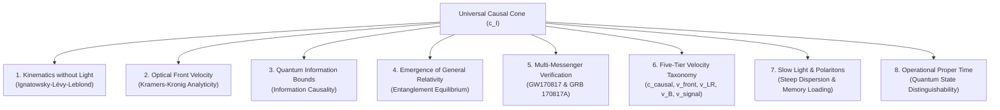

# Executive Summary & White Paper: The Speed of Information Paradigm in Theoretical Physics

**Document Title:** From Luminal Kinematics to a Universal Causal Information Cone: Operationalizing Spacetime Geometry, Quantum Speed Limits, and Multi-Messenger Tests  
**Author:** Stefan Hertel  
**Affiliation:** Independent Researcher  
**Date:** October 2026  
**Document Type:** Executive Scientific White Paper & Theoretical Synthesis  
**DOI:** [10.5281/zenodo.23402847](https://doi.org/10.5281/zenodo.23402847)  

---

## 1. The Core Research Question & Epistemic Verdict

```
                     THE CENTRAL SCIENTIFIC QUESTION
       "Does replacing the concept of 'speed of light' with 'speed of information'
        help us better understand the fundamental architecture of physics?"
```

### The Epistemic Verdict:
$$\boxed{\begin{array}{c}
\textbf{YES, when properly formulated within a disciplined epistemic framework.} \\
\text{While leaving the vacuum solutions of the classical Einstein-Maxwell equations} \\
\text{numerically invariant under the condition } m_\gamma = 0\text{, the transition from } c \to c_{\mathcal{I}} \\
\text{reverses the historical hierarchy: } \textbf{light does not dictate the causal structure;} \\
\textbf{the universal causal cone of spacetime governs the kinematics of all physical fields.}
\end{array}}$$

### Epistemic Tri-Partition:
1. **Tier I (Mathematically Proven & Established Physics):** The Ignatowsky derivation of Lorentz transformations without electromagnetism; Sommerfeld-Brillouin front velocity analyticity from Kramers-Kronig relations; QFT microcausality and no-signaling; Lieb-Robinson bounds in lattice Hamiltonians; Jacobson-Faulkner derivation of Einstein equations from entanglement equilibrium.
2. **Tier II (Conceptual & Operational Interpretations):** Interpreting $c_{\mathcal{I}}$ as an intrinsic causal metric horizon; operational interpretation of proper time $d\tau/dt = 1/\gamma$ as a geometric constraint on internal quantum state distinguishability rates; five-tier velocity hierarchy ($c_{\text{causal}}, v_{\text{front}}, v_{\text{LR}}, v_B, v_{\text{signal}}$).
3. **Tier III (Falsifiable Hypotheses & Frontiers):** The Universal Causal Cone Hypothesis ($c_{\text{EM}} = c_{\text{grav}} = c_{\text{matter}} = c_{\mathcal{I}}$) tested to $10^{-15}$ by GW170817; RG flow from microscopic lattice information cones to continuum Lorentz invariance; energy-dependent causal cones $c_{\mathcal{I}}(E)$ in Quantum Gravity phenomenology.

---

## 2. Executive Synthesis of the Core Theoretical Pillars



### Pillar 1: Spacetime Kinematics Independent of Electromagnetism
* **The Historical Relic:** In 1905, Einstein named $c$ "the speed of light" because Maxwellian electrodynamics provided the empirical catalyst.
* **The Mathematical Theorem:** Using group theory (Ignatowsky 1910, Frank & Rothe 1911, Lévy-Leblond 1976), Special Relativity follows strictly from **isotropy, homogeneity, and group closure**. No photons or electromagnetic equations are required.
* **Proca Decoupling:** If the photon carries a non-zero rest mass ($m_\gamma \le 10^{-18}\text{ eV}/c_{\mathcal{I}}^2$, as tested via astrophysical dispersion), physical light is dispersive ($v_\gamma(\omega) < c_{\mathcal{I}}$). Yet spacetime geometry, time dilation, and $E=mc_{\mathcal{I}}^2$ remain completely unaffected.

### Pillar 2: Wave Dynamics & Resolution of "Superluminal" Anomalies
* **The Optical Artifact:** In media with anomalous dispersion or gain lines, pulse envelopes can travel with group velocities $v_g > c$ or exhibit negative group delays.
* **Analytic Proof:** By Kramers-Kronig analyticity and Cauchy contour integration, the field amplitude for any signal switched on at $t = 0$ is **identically zero** for all $t < x / c_{\mathcal{I}}$.
* **The Resolution:** Superluminal group velocity is strictly an envelope-reshaping phenomenon. The physical front velocity (Sommerfeld-Brillouin precursor) carries non-analytic information and strictly satisfies $v_{\text{front}} = c_{\mathcal{I}}$.

### Pillar 3: Information Causality & Non-Local Correlation Bounds
* **Constraining Non-Locality:** Quantum non-local correlations are bounded by Tsirelson's bound ($S \le 2\sqrt{2} \approx 2.828$), excluding unphysical non-signaling distributions such as Popescu-Rohrlich (PR) boxes ($S = 4.0$).
* **Information Causality:** Under the principle of Information Causality (Pawłowski et al., *Nature* 2009), classical message transmission at $v \le c_{\mathcal{I}}$ bounds accessible mutual information: $\sum I(a_k : b_k) \le m$.
* **Disciplined Assessment:** Information Causality is a powerful necessary constraint on admissible non-local physics that isolates quantum correlations in bipartite settings, while multipartite generalizations remain an active area of foundational research.

### Pillar 4: General Relativity from Entanglement Equilibrium
* **Thermodynamic Gravity:** General Relativity can be formulated as an equation of state of quantum information (Jacobson 1995, 2016; Faulkner et al. 2014).
* **The Derivation:** On local geodesic causal diamonds $\mathcal{D}(p, R)$, the First Law of Entanglement Entropy ($\delta S_{\text{matter}} = \delta \langle \hat{K} \rangle$) balances against the Raychaudhuri horizon area deficit ($\delta S_{\text{UV}} = \frac{c_{\mathcal{I}}^3}{4G\hbar} \delta A$). Demanding maximal entanglement equilibrium ($\delta S_{\text{total}} = 0$) yields:
  $$\boxed{G_{\mu\nu} + \Lambda g_{\mu\nu} = \frac{8\pi G}{c_{\mathcal{I}}^4} T_{\mu\nu}}.$$
* **Critical Audit:** To avoid overclaiming, we explicitly account for assumed inputs (smooth Lorentzian manifold, Newton's constant $G$, and the entanglement stationarity postulate).

### Pillar 5: Multi-Messenger Verification & Universal Causal Cone
* **Falsifiable Physics:** Replacing $c \to c_{\mathcal{I}}$ motivates testing whether different physical sectors share the exact same causal cone: $c_{\text{EM}} = c_{\text{grav}} = c_{\text{matter}} = c_{\mathcal{I}}$.
* **Gravitational Wave Constraint:** The simultaneous observation of the binary neutron star merger GW170817 and GRB 170817A over a baseline of $40\text{ Mpc}$ establishes:
  $$-3 \times 10^{-15} \le \frac{c_{\text{grav}} - c_{\text{EM}}}{c_{\mathcal{I}}} \le +7 \times 10^{-16}.$$
* **Astrophysical Limits:** Cosmological FRBs and pulsar dispersion constrain $m_\gamma < 10^{-18}\text{ eV}/c_{\mathcal{I}}^2$, and Fermi GRB 090510 observations constrain Planck-scale Lorentz violations to $E_{\text{QG}} > 1.2\,M_{\text{Planck}}$.

### Pillar 6: Five-Tier Hierarchy of Physical Velocities
* Resolves category conflations by establishing a structured taxonomy:
  1. **Tier I (Geometric Causal Speed):** $c_{\text{causal}} \equiv c_{\mathcal{I}}$ (null cone $ds^2 = 0$).
  2. **Tier II (Field-Theoretic Front):** $v_{\text{front}} = c_{\mathcal{I}}$ (precursor wavefront).
  3. **Tier III (Lattice Speed):** $v_{\text{LR}} \propto J a / \hbar$ (effective quasi-causal cone in many-body spin systems).
  4. **Tier IV (Quantum Scrambling):** $v_B \le c_{\mathcal{I}}$ (butterfly velocity of operator spreading).
  5. **Tier V (Usable Signaling):** $v_{\text{signal}} \le c_{\mathcal{I}}$ (usable communication throughput).

### Pillar 7: Polariton Information Overhead & Slow Light
* **Mechanism:** Light slows down in EIT media ($v_g \to 17\text{ m/s}$ in sodium BECs or $v_g = 0$ in stopped light) because it forms a dark-state polariton $\hat{\Psi} = \cos\theta \hat{\mathcal{E}} - \sin\theta \sqrt{N} \hat{S}$.
* **Optical Dispersion vs. QSL:** We critically clarify that the slowdown is governed by steep dispersion ($dn/d\omega$) generated by quantum destructive interference in open driven systems, preserving the invariant front velocity $v_{\text{front}} = c_{\mathcal{I}}$ against misinterpretations of isolated-system Margolus-Levitin QSL dwell times.

### Pillar 8: Operational Proper Time and State Evolution
* **Kinematic Relation:** The equation $(d\tau/dt)^2 + (v/c_{\mathcal{I}})^2 = 1$ is the algebraic expression of the 4-velocity norm $u^\mu u_\mu = -c_{\mathcal{I}}^2$.
* **Operational Meaning:** It constrains the rate at which distinguishable quantum states can evolve along a worldline ($d N_{\text{ticks}}/dt \le \frac{2\Delta E}{\pi\hbar} \frac{1}{\gamma(v)}$), providing an operational grounding for time dilation without invoking a non-geometric "bandwidth fluid."

---

## 3. Project Architecture & Companion Works

The project is structured into two dedicated, publication-ready research programs:
1. **Foundational Theoretical Physics:**  
   [`Speed_of_Information_Paper.md`](file:///home/stefan/Projects/SpeedOfInformation/paper/Speed_of_Information_Paper.md) & [`Speed_of_Information_Paper.tex`](file:///home/stefan/Projects/SpeedOfInformation/paper/Speed_of_Information_Paper.tex)  
   Focused strictly on theoretical physics: axiomatic spacetime kinematics, front velocity analyticity, operational proper time, Lieb-Robinson RG flow, entanglement gravity, and multi-messenger tests.
2. **Computational Algorithms & Computer Science:**  
   [`Relativistic_Optimization_of_Algorithms.md`](file:///home/stefan/Projects/SpeedOfInformation/paper/Relativistic_Optimization_of_Algorithms.md) & [`Relativistic_Optimization_of_Algorithms.tex`](file:///home/stefan/Projects/SpeedOfInformation/paper/Relativistic_Optimization_of_Algorithms.tex)  
   A dedicated companion work exploring algorithmic optimizations inspired by causal diamond caching (L1-resident PDE solvers), holographic error correction (straggler-immune matrix multiplication), and cryptographic DAG pruning.
